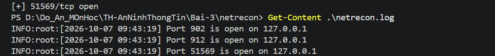
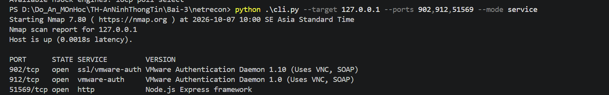
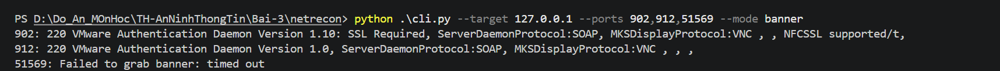
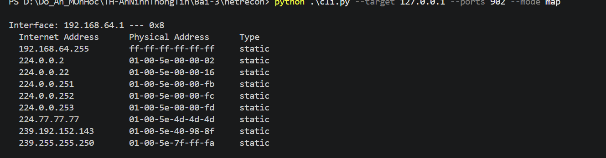
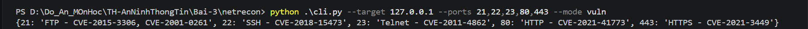
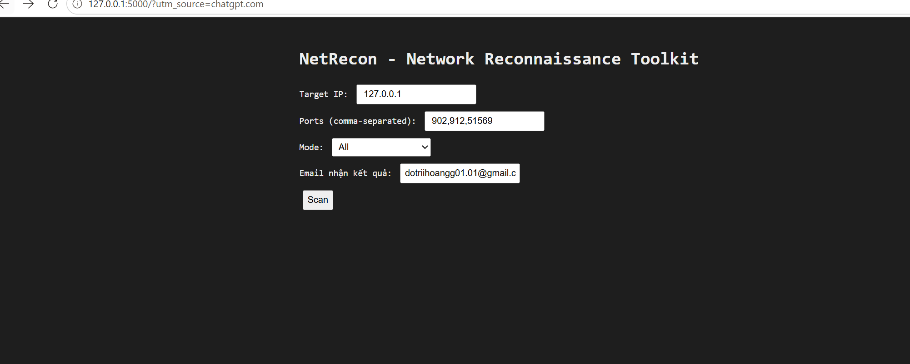

# NetRecon - Network Reconnaissance Toolkit

## 1. Giới thiệu

**NetRecon** là công cụ thực hành trinh sát mạng (Network
Reconnaissance) được xây dựng bằng Python, hỗ trợ CLI và giao diện Web
Flask.

Các chức năng đã thực hành: - Port Scanner - Service Detector bằng
Nmap - Banner Grabber - Network Mapper bằng bảng ARP - Vulnerability
Checker (tra cứu CVE mẫu theo cổng) - Gửi kết quả qua Gmail SMTP - Web
Interface bằng Flask

## 2. Cấu trúc dự án

``` text
netrecon/
|-- .env
|-- app.py
|-- cli.py
|-- requirements.txt
|-- README.md
|-- modules/
|   |-- banner_grabber.py
|   |-- email_sender.py
|   |-- filter_utils.py
|   |-- network_mapper.py
|   |-- port_scanner.py
|   |-- service_detector.py
|   |-- vuln_checker.py
|   `-- __init__.py
|-- static/
|   `-- style.css
|-- templates/
|   |-- index.html
|   |-- layout.html
|   `-- result.html
`-- images/
```

## 3. Cài đặt

Di chuyển vào dự án:

``` powershell
cd D:\Do_An_MOnHoc\TH-AnNinhThongTin\Bai-3\netrecon
```

Cài thư viện:

``` powershell
python -m pip install -r requirements.txt
```

Kiểm tra Nmap:

``` powershell
nmap --version
```

Trên máy thực hành, Nmap được tìm thấy tại:

``` text
C:\Program Files (x86)\Nmap\nmap.exe
```

Nếu PowerShell chưa nhận Nmap trong terminal hiện tại:

``` powershell
$env:Path += ";C:\Program Files (x86)\Nmap"
```

## 4. Port Scanner

``` powershell
python .\cli.py --target 127.0.0.1 --ports 902,912,51569 --mode scan
```

Kết quả:

``` text
[+] 902/tcp open
[+] 912/tcp open
[+] 51569/tcp open
```

Xem log:

``` powershell
Get-Content .\netrecon.log
```

### Ảnh minh họa



## 5. Service Detector

``` powershell
python .\cli.py --target 127.0.0.1 --ports 902,912,51569 --mode service
```

Kết quả:

``` text
PORT      STATE SERVICE         VERSION
902/tcp   open  ssl/vmware-auth VMware Authentication Daemon 1.10 (Uses VNC, SOAP)
912/tcp   open  vmware-auth     VMware Authentication Daemon 1.0 (Uses VNC, SOAP)
51569/tcp open  http            Node.js Express framework
```

### Ảnh minh họa



## 6. Banner Grabber

``` powershell
python .\cli.py --target 127.0.0.1 --ports 902,912,51569 --mode banner
```

Kết quả:

``` text
902: 220 VMware Authentication Daemon Version 1.10: SSL Required, ServerDaemonProtocol:SOAP, MKSDisplayProtocol:VNC
912: 220 VMware Authentication Daemon Version 1.0, ServerDaemonProtocol:SOAP, MKSDisplayProtocol:VNC
51569: Failed to grab banner: timed out
```

Cổng 51569 timeout không có nghĩa Port Scanner bị lỗi. Banner Grabber
hiện kết nối TCP rồi chờ dịch vụ tự gửi dữ liệu; HTTP server có thể yêu
cầu client gửi HTTP request trước.

### Ảnh minh họa



## 7. Network Mapper

``` powershell
python .\cli.py --target 127.0.0.1 --ports 902 --mode map
```

Module chạy `arp -a` và hiển thị các thông tin như: - Interface -
Internet Address - Physical Address - Type (dynamic/static)

### Ảnh minh họa



## 8. Vulnerability Checker

``` powershell
python .\cli.py --target 127.0.0.1 --ports 21,22,23,80,443 --mode vuln
```

Kết quả:

``` text
{21: 'FTP - CVE-2015-3306, CVE-2001-0261',
 22: 'SSH - CVE-2018-15473',
 23: 'Telnet - CVE-2011-4862',
 80: 'HTTP - CVE-2021-41773',
 443: 'HTTPS - CVE-2021-3449'}
```

**Lưu ý:** module hiện tại chỉ ánh xạ số cổng với chuỗi CVE được khai
báo sẵn trong `VULN_PORTS`. Kết quả không xác nhận máy đích thực sự mắc
các CVE này.

### Ảnh minh họa



## 9. Cấu hình Email

File `.env`:

``` text
SMTP_USER=your_email@gmail.com
SMTP_PASS=your_app_password
```

`email_sender.py` sử dụng Gmail SMTP qua `smtp.gmail.com`, cổng 465 và
`SMTP_SSL`.

Không đưa App Password thật lên GitHub. Nên thêm vào `.gitignore`:

``` text
.env
```

## 10. Chạy Web Interface

``` powershell
python .\app.py
```

Ứng dụng Flask được cấu hình chạy tại:

``` text
http://127.0.0.1:5000
```

Giao diện cho phép nhập Target IP, Ports, Mode và Email nhận kết quả.

### Ảnh giao diện Web



## 11. Test Web

Có thể thử trên localhost:

``` text
Target IP: 127.0.0.1
Ports: 902,912,51569
Mode: All
Email: email nhận kết quả
```

Mode `All` gọi lần lượt các chức năng Port Scanner, Service Detector,
Banner Grabber, Network Mapper, Vulnerability Checker và sau đó gửi kết
quả qua email.

### Ảnh kết quả Web


### Ảnh email nhận kết quả

*Do Không Dùng Gmail Thật Nên Không Có Ảnh Kết Quả Gứi Về Gmail!

## 12. Các mode CLI

  Mode        Chức năng
  ----------- -----------------------------
  `scan`      Quét cổng TCP
  `service`   Nhận diện dịch vụ bằng Nmap
  `banner`    Thu thập banner
  `map`       Hiển thị bảng ARP
  `vuln`      Tra cứu CVE mẫu theo cổng
  `all`       Chạy tất cả chức năng

Cú pháp:

``` powershell
python .\cli.py --target <IP> --ports <PORTS> --mode <MODE>
```

## 13. Kết quả thực hành

NetRecon đã thực hiện thành công: - Phát hiện các cổng TCP đang mở trên
localhost. - Nhận diện VMware Authentication Daemon và Node.js Express
bằng Nmap. - Thu thập banner trên cổng 902 và 912. - Hiển thị bảng ARP
của máy. - Tra cứu thông tin CVE mẫu theo số cổng. - Khởi chạy thành
công giao diện Flask. - Hỗ trợ gửi kết quả qua Gmail SMTP khi `.env`
được cấu hình hợp lệ.

Kết quả tiêu biểu:

``` text
902/tcp   -> VMware Authentication Daemon 1.10
912/tcp   -> VMware Authentication Daemon 1.0
51569/tcp -> Node.js Express framework
```

## 15. Kết luận

NetRecon minh họa quy trình reconnaissance cơ bản trong môi trường thực
hành mạng. Công cụ kết hợp Python, socket, asyncio, Nmap, ARP, Flask và
SMTP để cung cấp cả giao diện dòng lệnh và giao diện Web.

Qua bài thực hành có thể quan sát quy trình từ phát hiện cổng mở, nhận
diện dịch vụ, thu thập banner, thu thập thông tin mạng, tham chiếu CVE
và trình bày/gửi kết quả cho người dùng.
