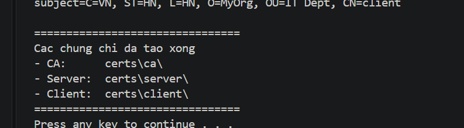
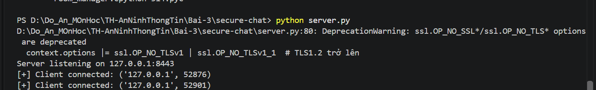
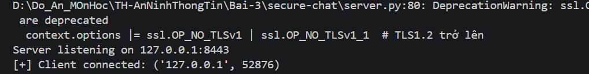
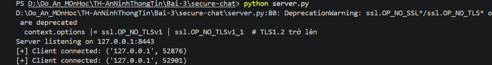
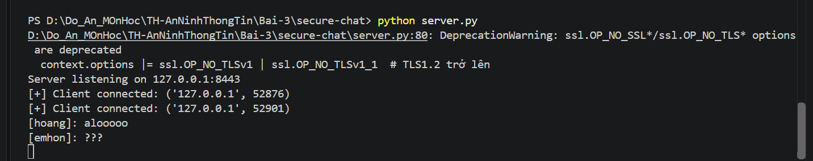

# BÀI 3 - BẢO MẬT MẠNG MÁY TÍNH

## Thực hành Secure Chat sử dụng TLS và AES

## 1. Mục tiêu

Xây dựng chương trình Secure Chat cho phép nhiều Client giao tiếp với
nhau thông qua Server.

Hệ thống sử dụng:

-   Socket TCP để kết nối Client - Server.
-   TLS/SSL và Certificate để bảo vệ/xác thực kết nối.
-   AES-256 để mã hóa nội dung tin nhắn.
-   Threading để xử lý nhiều Client.
-   Connection Manager và Room Manager để quản lý kết nối/phòng chat.

------------------------------------------------------------------------

## 2. Mô hình hoạt động

``` text
Client 1 (Hoang)            Client 2 (emhon)
       \                       /
        \    TLS/SSL          /
         \                   /
          +-----------------+
          |     SERVER      |
          | 127.0.0.1:8443 |
          +-----------------+
```

Client gửi tin nhắn đến Server. Server xử lý và chuyển tiếp tin nhắn đến
Client còn lại.

------------------------------------------------------------------------

## 3. Cấu trúc chương trình

``` text
secure-chat/
├── certs/
│   ├── ca/
│   ├── client/
│   └── server/
├── client.py
├── connection_manager.py
├── make-certs.bat
├── message_encryption.py
├── openssl.cnf
├── room_manager.py
├── server.py
└── README.md
```

  File                      Chức năng
  ------------------------- --------------------------------------------------
  `server.py`               Khởi tạo Server và tiếp nhận kết nối Client
  `client.py`               Kết nối đến Server, gửi và nhận tin nhắn
  `message_encryption.py`   Mã hóa và giải mã tin nhắn
  `connection_manager.py`   Quản lý Client đang kết nối
  `room_manager.py`         Quản lý phòng chat
  `make-certs.bat`          Tạo CA, Server Certificate và Client Certificate
  `openssl.cnf`             Cấu hình OpenSSL
  `certs/`                  Chứa certificate và private key

------------------------------------------------------------------------

## 4. Tạo Certificate

Kiểm tra OpenSSL:

``` powershell
openssl version
```

Tạo certificate:

``` powershell
.\make-certs.bat
```

Sau khi hoàn thành, các certificate được lưu trong:

``` text
certs/ca/
certs/server/
certs/client/
```


------------------------------------------------------------------------

## 5. Khởi động Server

Mở Terminal thứ nhất:

``` powershell
python server.py
```

Kết quả mong đợi:

``` text
Server listening on 127.0.0.1:8443
```



------------------------------------------------------------------------

## 6. Khởi động Client 1

Mở Terminal thứ hai:

``` powershell
python client.py
```

Ví dụ:

``` text
Username: Hoang
Type messages (type 'exit' to quit):
```



------------------------------------------------------------------------

## 7. Khởi động Client 2

Mở Terminal thứ ba:

``` powershell
python client.py
```

Ví dụ:

``` text
Username: emhon
Type messages (type 'exit' to quit):
```



------------------------------------------------------------------------

## 8. Kiểm thử gửi và nhận tin nhắn



------------------------------------------------------------------------

## 9. Cơ chế bảo mật

### TLS/SSL

Server sử dụng SSL Context và certificate để thiết lập kết nối TLS.
Server yêu cầu Client Certificate:

``` python
context.verify_mode = ssl.CERT_REQUIRED
```

### AES-256

Mỗi Client tạo AES key 256-bit:

``` python
aes_key = os.urandom(32)
```

`32 bytes = 256 bits`.

Key được sử dụng bởi `MessageEncryption` để mã hóa và giải mã nội dung
tin nhắn.

### Quản lý kết nối

`ConnectionManager` quản lý các Client đang kết nối và thông tin cần
thiết của từng Client.

`RoomManager` quản lý phòng chat. Trong bài thực hành, Client mặc định
tham gia phòng `general`.

------------------------------------------------------------------------

## 10. Kết quả thực hành

-   [x] Tạo CA Certificate.
-   [x] Tạo Server Certificate.
-   [x] Tạo Client Certificate.
-   [x] Khởi động Server tại `127.0.0.1:8443`.
-   [x] Client kết nối được đến Server.
-   [x] Hai Client kết nối đồng thời.
-   [x] Client gửi và nhận tin nhắn thành công.
-   [x] Hai Client chat hai chiều thông qua Server.


------------------------------------------------------------------------

## 11. Kết luận

Bài thực hành đã xây dựng và chạy thành công ứng dụng Secure Chat theo
mô hình Client - Server.

Server chạy tại `127.0.0.1:8443`, tiếp nhận đồng thời nhiều Client. Hai
Client đã kết nối và trao đổi tin nhắn hai chiều thành công.

Thông qua bài thực hành có thể tìm hiểu các nội dung chính như Socket
Programming, TLS/SSL, CA và Digital Certificate, AES-256,
Multi-threading và quản lý kết nối trong ứng dụng mạng.

------------------------------------------------------------------------

## Thư mục ảnh đề xuất

Tạo thư mục `images` bên cạnh `README.md`:

``` text
secure-chat/
├── images/
│   ├── 01-create-certificate.png
│   ├── 02-server.png
│   ├── 03-client-1.png
│   ├── 04-client-2.png
│   ├── 05-secure-chat-result.png
│   └── 06-overview.png
├── README.md
├── server.py
├── client.py
└── ...
```
