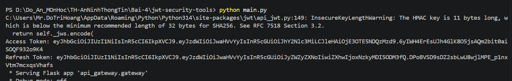
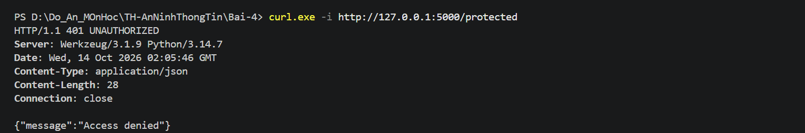
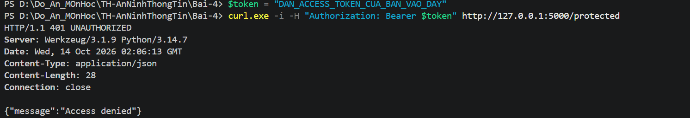
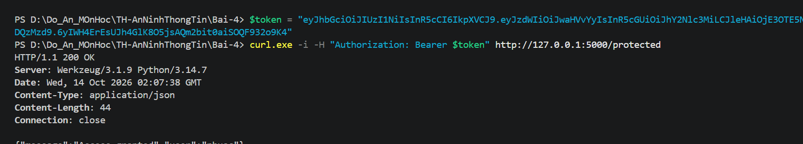

# Bài 2 – JWT Security Tools

## 1. Giới thiệu
Dự án Python thực hành tạo và kiểm tra JWT, Access Token/Refresh Token, API Gateway bảo vệ endpoint, xác minh chữ ký, thử khóa từ wordlist trong môi trường lab và tạo URL ủy quyền OAuth. Dự án hiện là **API/ứng dụng dòng lệnh**, không có trang chủ giao diện web.

## 2. Môi trường đã sử dụng
- Windows, VS Code, PowerShell, Python **3.14.7**.
- Các thư viện theo `requirements.txt`: `PyJWT`, `requests`, `flask`, `pytest`.
- Nhật ký ghi nhận PyJWT **2.15.1**, Flask **3.1.3**, pytest **9.1.1**.

## 3. Cấu trúc và chức năng
```text
jwt-security-tools/
├── main.py
├── requirements.txt
├── pytest.ini
├── api_gateway/gateway.py
├── token_manager/manager.py
├── jwt_validator/validator.py
├── jwt_cracker/cracker.py
├── oauth_client/client.py
└── tests/                    # 7 bài kiểm thử
```

- `TokenManager`: tạo Access Token mặc định 15 phút, Refresh Token mặc định 24 giờ; có phương thức `refresh_access_token()`.
- `JWTValidator`: xác minh token, phân biệt token hết hạn và chữ ký không đúng.
- `APIGateway`: Flask chạy cổng 5000, endpoint `GET /protected`, kiểm tra JWT từ header Authorization.
- `JWTCracker`: thử các khóa từ wordlist để minh họa nguy cơ khóa ký yếu; chỉ dùng với token lab của mình.
- `OAuthClient`: tạo URL authorization và phương thức đổi authorization code lấy token; chưa có minh chứng đăng nhập OAuth thực tế với nhà cung cấp.

**Giới hạn của bản mã hiện tại:** endpoint `/protected` kiểm tra chữ ký và thời hạn JWT, nhưng **chưa kiểm tra claim `type` phải bằng `access`**. Vì vậy không nên xem đây là API Gateway sẵn sàng triển khai thực tế. Dự án không khai báo endpoint HTTP `/refresh` hoặc `/login`.

## 4. Cài đặt và khởi động
Từ thư mục `Bai-4` trong VS Code:
```powershell
cd jwt-security-tools
python -m pip install -r requirements.txt
python main.py
```

Kết quả đã ghi nhận:
```text
Access Token: <JWT được tạo khi chạy>
Refresh Token: <JWT được tạo khi chạy>
* Serving Flask app 'api_gateway.gateway'
* Debug mode: off
* Running on http://127.0.0.1:5000
```


Trong `main.py`, ví dụ tạo token cho user `phuoc`. **Không dùng lại token trong log cũ:** token có thời hạn, hãy lấy token mới từ Terminal khi chạy. Giữ Terminal server mở, tạo một Terminal khác để thử API.

## 5. Kiểm tra API bằng PowerShell

### Trường hợp 1: Không có token
```powershell
curl.exe -i http://127.0.0.1:5000/protected
```

Kết quả đã xác nhận:
```text
HTTP/1.1 401 UNAUTHORIZED
{"message":"Access denied"}
```


### Trường hợp 2: Token không hợp lệ
```powershell
$token = "DAN_ACCESS_TOKEN_CUA_BAN_VAO_DAY"
curl.exe -i -H "Authorization: Bearer $token" http://127.0.0.1:5000/protected
```

Kết quả đã ghi nhận khi để nguyên chuỗi giữ chỗ:
```text
HTTP/1.1 401 UNAUTHORIZED
{"message":"Access denied"}
```


### Trường hợp 3: Access Token hợp lệ
Sao chép **Access Token mới nhất** từ Terminal chạy `python main.py`. Phải đặt token trong dấu ngoặc kép:
```powershell
$token = "<DAN_ACCESS_TOKEN_MOI_VAO_DAY>"
curl.exe -i -H "Authorization: Bearer $token" http://127.0.0.1:5000/protected
```

Kết quả thực tế đã xác nhận:
```text
HTTP/1.1 200 OK
{"message":"Access granted","user":"phuoc"}
```


Điều này chứng minh API từ chối yêu cầu thiếu token và cho phép token hợp lệ trong lần kiểm tra được ghi nhận.


## 6. Kiểm thử tự động
Trong thư mục `jwt-security-tools`:
```powershell
python -m pytest -v
```

| Bài kiểm thử | Kết quả |
|---|---|
| `test_protected_route_with_valid_token` | PASSED |
| `test_protected_route_with_invalid_token` | PASSED |
| `test_crack_token` | PASSED |
| `test_auth_url` | PASSED |
| `test_token_creation_and_refresh` | PASSED |
| `test_valid_token` | PASSED |
| `test_invalid_signature` | PASSED |

**Kết quả: 7 passed, 19 warnings** (nhật ký ghi nhận 0.21s ở lần chạy sau). Các unit test về refresh, validator, cracker và OAuth không có nghĩa đã chạy đủ luồng tương tác HTTP cho các chức năng đó.


## 7. Kết quả và kết luận
Đã cài phụ thuộc, tạo Access Token và Refresh Token, chạy Flask API Gateway, xác nhận phản hồi `401` khi không có token/token không hợp lệ và `200` khi có Access Token hợp lệ; hoàn thành 7/7 unit test. Chưa có bằng chứng thực hiện đổi Refresh Token qua HTTP hay đăng nhập OAuth thực tế. Trước khi sử dụng ngoài môi trường lab cần cải thiện quản lý khóa ký, kiểm tra loại token và hoàn thiện luồng xác thực.
