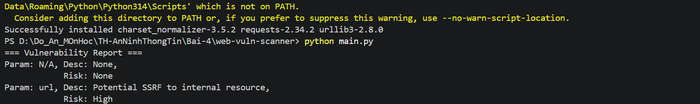
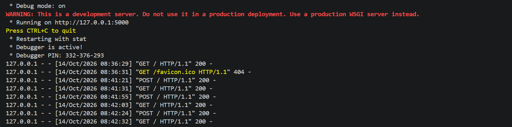
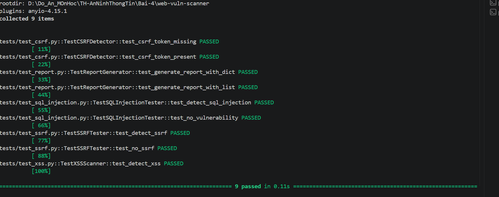

# Bài 1 – Web Vulnerability Scanner

## 1. Giới thiệu
Dự án Python minh họa các cách kiểm tra dấu hiệu SQL Injection, XSS, CSRF, SSRF và tổng hợp kết quả. Đây là công cụ học tập, **không phải trình quét xác nhận lỗ hổng toàn diện**. Chỉ kiểm tra các website do mình quản lý hoặc được phép kiểm thử.

## 2. Môi trường đã sử dụng
- Windows, Visual Studio Code, Terminal PowerShell.
- Python **3.14.7**; Flask **3.1.3**; requests **2.34.2**; pytest **9.1.1** (theo nhật ký thực hành).
- Các gói được khai báo trong `requirements.txt`: Flask, requests. `pytest` được cài thêm để kiểm thử.

## 3. Các thành phần trong mã nguồn
```text
web-vuln-scanner/
├── main.py                    # Chạy ví dụ kiểm tra và in báo cáo
├── requirements.txt
├── scanners/
│   ├── sql_injection_tester.py
│   ├── xss_scanner.py
│   ├── csrf_detector.py
│   └── ssrf_tester.py
├── report/report_generator.py
├── ui/app.py                  # Giao diện Flask
├── ui/templates/             # HTML giao diện và kết quả
└── tests/                    # 9 bài kiểm thử
```

- **SQL Injection:** phân tích tham số URL và đối chiếu với các chuỗi mẫu; không tự chứng minh rằng cơ sở dữ liệu thực sự bị khai thác.
- **XSS:** gửi yêu cầu GET thử với payload và tìm chuỗi phản hồi; chưa xác minh việc JavaScript có thực thi trong trình duyệt.
- **CSRF:** tìm tên trường token CSRF trong chuỗi HTML; đây là phép kiểm tra sơ bộ.
- **SSRF:** nhận diện địa chỉ nội bộ/localhost trong tham số URL; chỉ là dấu hiệu tiềm năng.
- **ReportGenerator:** gộp các kết quả dạng danh sách hoặc từ điển.

## 4. Các bước chạy trên VS Code
Mở thư mục `Bai-4` bằng **File → Open Folder**, sau đó mở **Terminal → New Terminal**.

```powershell
cd web-vuln-scanner
python --version
python -m pip install -r requirements.txt
python main.py
```


### Kết quả chạy `main.py` đã ghi nhận
```text
=== Vulnerability Report ===
Param: N/A, Desc: None,
            Risk: None
Param: url, Desc: Potential SSRF to internal resource,
            Risk: High
```


Dòng `Param: N/A` xuất hiện vì `ReportGenerator` giữ lại cả từ điển `csrf_protected` không có các trường `param`, `desc`, `risk`. Dòng SSRF là dấu hiệu từ URL mẫu trong mã, **không phải bằng chứng website thực bị tấn công**.

## 5. Chạy giao diện Flask
```powershell
python ui/app.py
```

Truy cập: **http://127.0.0.1:5000/**. Chọn các loại kiểm tra, nhập URL của ứng dụng lab được phép thử và gửi biểu mẫu. Dùng `Ctrl + C` để dừng server.

Nhật ký thực tế ghi nhận:
```text
* Serving Flask app 'app'
* Debug mode: on
* Running on http://127.0.0.1:5000
"GET / HTTP/1.1" 200
"POST / HTTP/1.1" 200
```
Giao Diện UI




Như vậy giao diện đã phục vụ được GET và POST. Các dòng `GET /favicon.ico 404` chỉ cho biết chưa có biểu tượng favicon; không phải lỗi trang chủ. Chế độ debug chỉ nên dùng ở môi trường phát triển.

**Lưu ý về CSRF trên giao diện:** `ui/app.py` hiện truyền chuỗi HTML mẫu `<html><form></form></html>` vào bộ kiểm tra CSRF, không lấy HTML của URL người dùng nhập. Vì vậy kết quả CSRF ở giao diện không xác nhận tình trạng CSRF của website đích.

## 6. Kiểm thử tự động
```powershell
python -m pip install pytest
python -m pytest -v
```

Kết quả đã thực hiện trên máy:

| Bài kiểm thử | Kết quả |
|---|---|
| `test_csrf_token_missing` | PASSED |
| `test_csrf_token_present` | PASSED |
| `test_generate_report_with_dict` | PASSED |
| `test_generate_report_with_list` | PASSED |
| `test_detect_sql_injection` | PASSED |
| `test_no_vulnerability` | PASSED |
| `test_detect_ssrf` | PASSED |
| `test_no_ssrf` | PASSED |
| `test_detect_xss` | PASSED |

**Tổng cộng: 9 passed in 0.10s** (một lần chạy được ghi nhận). Đây là kết quả unit test với dữ liệu thử, không phải chứng nhận độ chính xác trên website thực.


## 7. Tổng kết thực hành
Đã cài thư viện, chạy chương trình dòng lệnh, mở giao diện Flask, gửi các yêu cầu GET/POST và hoàn thành 9/9 bài unit test. Kết quả báo cáo ví dụ có cảnh báo SSRF mức High. Những phát hiện dựa trên mẫu hoặc so khớp chuỗi cần được kiểm chứng bổ sung trước khi kết luận website có lỗ hổng.
