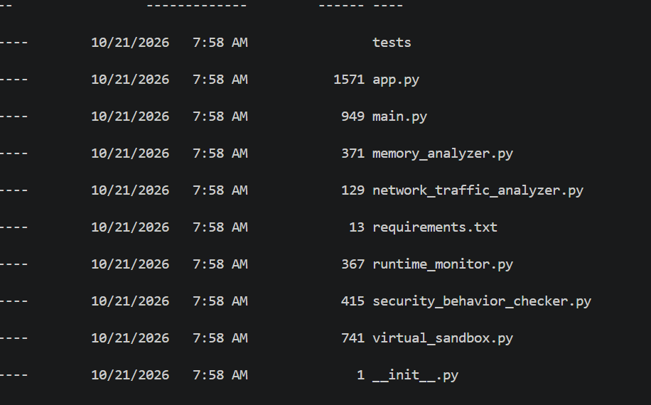
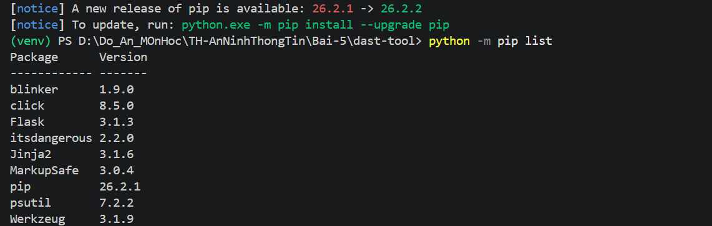
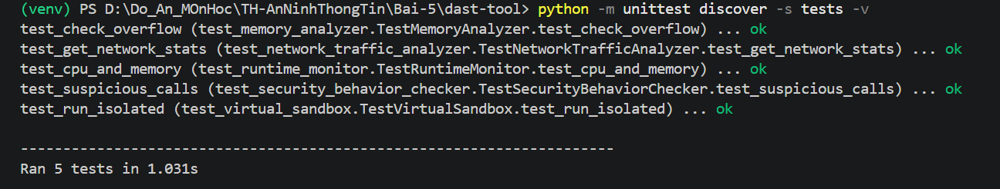
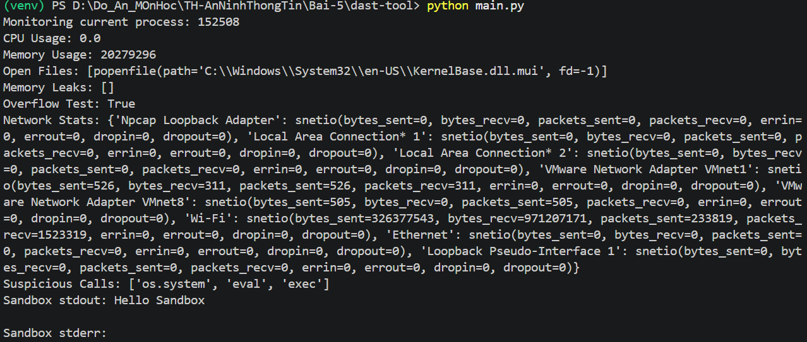
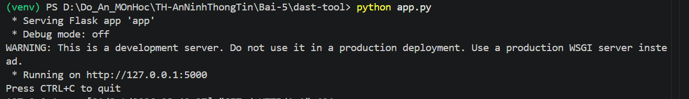
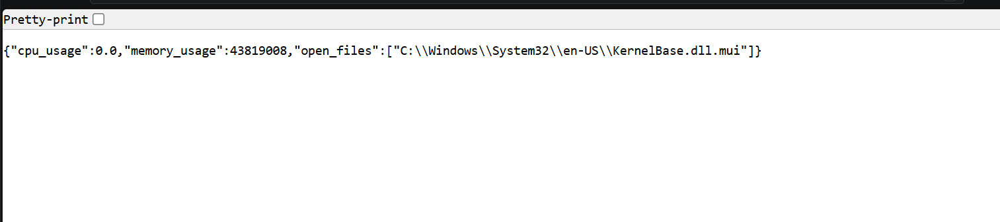
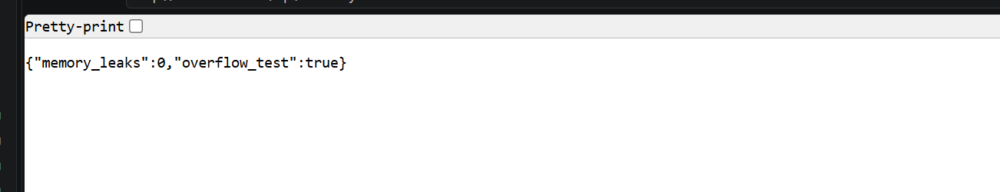
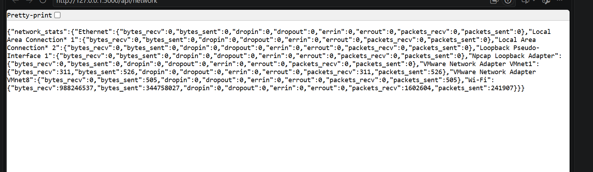
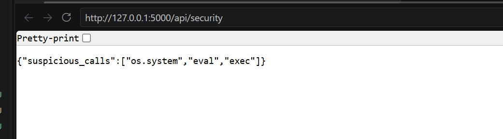
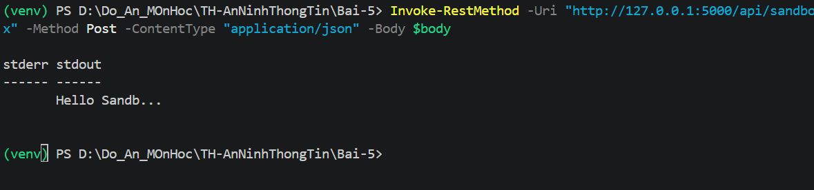

# LAB 05 – DAST-TOOL: PHÂN TÍCH VÀ KIỂM THỬ BẢO MẬT ĐỘNG

## 1. Giới thiệu

Bài thực hành 5.4 trong **Lab 05 – Phân tích và kiểm thử bảo mật** xây dựng công cụ phân tích động (DAST) bằng Python. Chương trình minh họa việc theo dõi hành vi khi thực thi, kiểm tra bộ nhớ, thống kê kết nối mạng, nhận diện hành vi nghi ngờ và cung cấp các API giám sát bằng Flask.

## 2. Môi trường thực hành

- Hệ điều hành: Windows, PowerShell
- Trình soạn thảo: Visual Studio Code
- Ngôn ngữ: Python 3 (môi trường ảo `venv`)
- Thư viện: Flask, psutil (theo `requirements.txt`)
- Kiểm thử: `unittest`

## 3. Cấu trúc thư mục

```text
dast-tool/
├── app.py
├── main.py
├── memory_analyzer.py
├── network_traffic_analyzer.py
├── runtime_monitor.py
├── security_behavior_checker.py
├── virtual_sandbox.py
├── requirements.txt
├── tests/
│   ├── test_memory_analyzer.py
│   ├── test_network_traffic_analyzer.py
│   ├── test_runtime_monitor.py
│   ├── test_security_behavior_checker.py
│   └── test_virtual_sandbox.py
├── images/
└── README.md
```


## 4. Cài đặt trên VS Code

Mở thư mục `dast-tool` trong VS Code và chạy tại Terminal PowerShell:

```powershell
python -m venv venv
.\venv\Scripts\Activate.ps1
python -m pip install -r requirements.txt
```

Nếu PowerShell chặn kích hoạt `venv`, có thể áp dụng cho **phiên terminal hiện tại**:

```powershell
Set-ExecutionPolicy -Scope Process -ExecutionPolicy Bypass
.\venv\Scripts\Activate.ps1
```



## 5. Kiểm thử đơn vị

```powershell
python -m unittest discover -s tests -v
```

Năm bài kiểm thử tương ứng với `MemoryAnalyzer`, `NetworkTrafficAnalyzer`, `RuntimeMonitor`, `SecurityBehaviorChecker` và `VirtualSandbox`.

Trong quá trình thực hành, bài kiểm thử `test_run_isolated` ban đầu thất bại do lệnh `echo` không được thực thi theo cách mong đợi trên Windows. Phần mô phỏng lệnh trong `virtual_sandbox.py` đã được điều chỉnh để xử lý `echo` và `printf` mà không gọi shell. **Chỉ ghi nhận 5/5 PASS sau khi thực sự chạy lại và xác nhận kết quả.**


## 6. Chạy chương trình giám sát

```powershell
python main.py
```

Các nhóm thông tin cần quan sát: mức dùng CPU/RAM, file đang mở, kết quả kiểm tra bộ nhớ cơ bản, thống kê kết nối mạng, hành vi nghi ngờ và kết quả lệnh thử nghiệm.



## 7. Khởi động Flask API

```powershell
python app.py
```

Truy cập: `http://127.0.0.1:5000/`.

Trong quá trình thực hành, trang chủ đã trả về JSON với `application: LAB 05 - DAST Tool` và `status: running`. Flask sử dụng development server, chỉ phục vụ chạy thử trên máy cá nhân.



## 8. Kiểm thử API

Giữ terminal chạy Flask; dùng trình duyệt hoặc terminal PowerShell thứ hai để kiểm tra.

### 8.1. Giám sát tiến trình – GET `/api/monitor`

Truy cập `http://127.0.0.1:5000/api/monitor`.



### 8.2. Phân tích bộ nhớ – GET `/api/memory`



### 8.3. Thống kê mạng – GET `/api/network`

Truy cập `http://127.0.0.1:5000/api/network`.



### 8.4. Kiểm tra hành vi – GET `/api/security`

Truy cập `http://127.0.0.1:5000/api/security`.



### 8.5. Lệnh thử nghiệm – POST `/api/sandbox`

Trong PowerShell:

```powershell
$body = @{command = @("echo", "Hello Sandbox")} | ConvertTo-Json -Compress
Invoke-RestMethod -Uri "http://127.0.0.1:5000/api/sandbox" -Method Post -ContentType "application/json" -Body $body
```

Kết quả mong đợi: trường `stdout` chứa `Hello Sandbox`. Không gửi lệnh nguy hiểm hoặc sử dụng API này như một môi trường thực thi an toàn.



## 9. Kết quả đã ghi nhận

| Hạng mục | Kết quả |
|---|---|
| Flask tại `127.0.0.1:5000` | Đã khởi động thành công |
| Trang chủ `/` | Đã hiển thị JSON trạng thái chạy |
| GET `/api/memory` | HTTP 200 trong log |
| GET `/api/network` | HTTP 200 trong log |
| GET `/api/security` | HTTP 200 trong log |
| POST `/api/sandbox` | HTTP 200 trong log; cần lưu phản hồi JSON để minh chứng nội dung |
| GET `/api/monitor` | Cần lưu kết quả JSON để minh chứng |
| Unit Test | Lần đầu 4/5 PASS; cần ảnh xác nhận kết quả sau khi sửa |

> HTTP 200 cho biết máy chủ đã xử lý yêu cầu ở mức HTTP, chưa đủ để khẳng định nội dung dữ liệu luôn chính xác.

## 10. Kết luận

Bài thực hành giúp làm quen với kiểm thử bảo mật động, theo dõi hành vi ứng dụng và xây dựng API giám sát bằng Flask. DAST trong bài lab bổ sung góc nhìn khi chạy chương trình so với phần SAST phân tích mã nguồn, nhưng không thay thế các công cụ kiểm thử bảo mật chuyên dụng.


