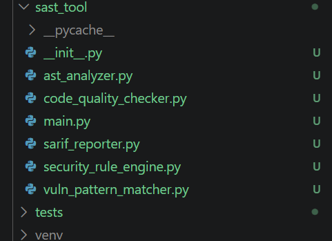
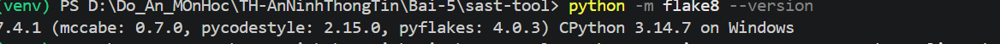
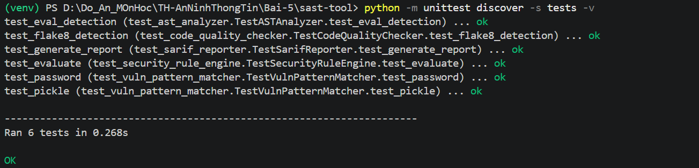
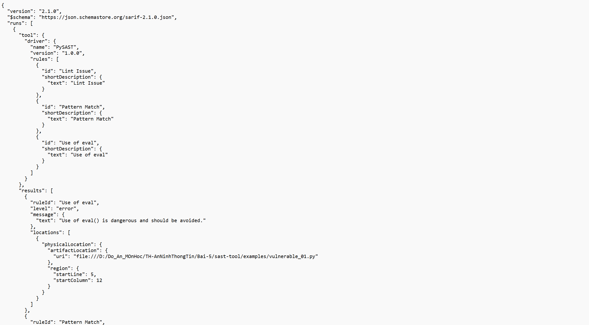
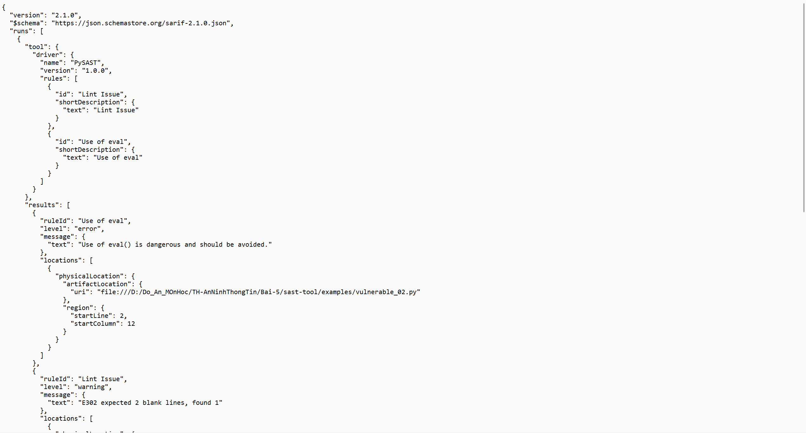
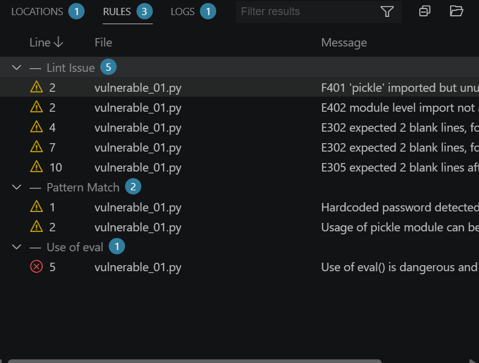
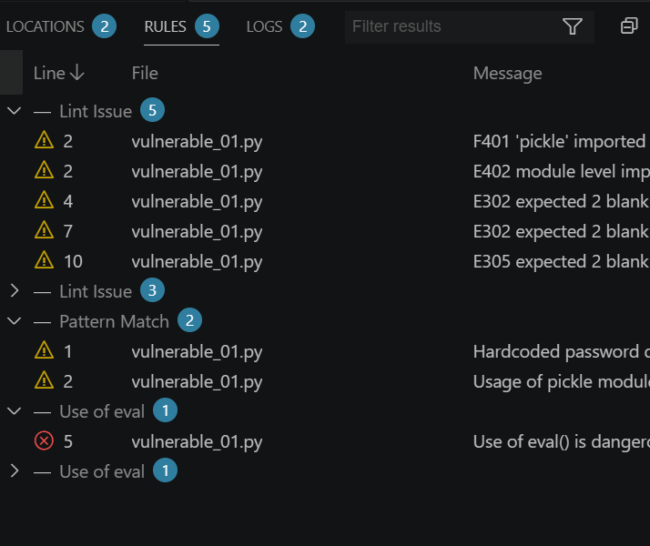

# LAB 05 – PHÂN TÍCH VÀ KIỂM THỬ BẢO MẬT (SAST-TOOL)

## 1. Giới thiệu

Bài thực hành số 05 tập trung vào **Static Application Security Testing (SAST)** và **Dynamic Application Security Testing (DAST)**. README này ghi lại **phần SAST-Tool đã thực hiện** bằng **Python trên Visual Studio Code (Windows, PowerShell)**.

Mục tiêu SAST: phân tích mã nguồn Python **mà không cần chạy ứng dụng đích**, phát hiện các mẫu code có rủi ro, kiểm tra chất lượng mã và xuất báo cáo theo chuẩn **SARIF**.

Các thành phần theo tài liệu:

- `ASTAnalyzer`: phân tích cây cú pháp trừu tượng (AST).
- `VulnPatternMatcher`: phát hiện mẫu mã có rủi ro.
- `SecurityRuleEngine`: xử lý các luật bảo mật.
- `CodeQualityChecker`: kiểm tra chất lượng mã nguồn với Flake8.
- `SarifReporter`: xuất kết quả theo định dạng SARIF.

## 2. Môi trường thực hiện

| Thành phần | Môi trường |
|---|---|
| Hệ điều hành | Windows |
| Trình soạn thảo | Visual Studio Code |
| Terminal | PowerShell tích hợp trong VS Code |
| Ngôn ngữ | Python 3 (môi trường ảo `venv`) |
| Thư viện | Theo `requirements.txt` của dự án |
| Công cụ xem kết quả | SARIF Viewer (VS Code) |



## 3. Cấu trúc thư mục

```text
sast-tool/
├── examples/
│   ├── vulnerable_01.py
│   └── vulnerable_02.py
├── rules/
│   └── default_rules.json
├── sast_tool/
│   ├── __init__.py
│   ├── ast_analyzer.py
│   ├── vuln_pattern_matcher.py
│   ├── security_rule_engine.py
│   ├── code_quality_checker.py
│   ├── sarif_reporter.py
│   └── main.py
├── tests/
│   ├── __init__.py
│   ├── test_ast_analyzer.py
│   ├── test_code_quality_checker.py
│   ├── test_sarif_reporter.py
│   ├── test_security_rule_engine.py
│   └── test_vuln_pattern_matcher.py
├── requirements.txt
├── report.sarif          # Sinh ra khi chạy phân tích
├── report_01.sarif       # Bản sao báo cáo ví dụ 01
└── report_02.sarif       # Bản sao báo cáo ví dụ 02
```

> Các file báo cáo SARIF chỉ xuất hiện sau khi chạy các lệnh phân tích và sao chép như phần 6.

## 4. Cài đặt và kích hoạt môi trường ảo

Mở thư mục `sast-tool` trong VS Code, sau đó mở **Terminal → New Terminal**.

Kiểm tra Python:

```powershell
python --version
```

Tạo môi trường ảo:

```powershell
python -m venv venv
```

Trong quá trình thực hiện, PowerShell chặn file `Activate.ps1` do chính sách thực thi script. Đã xử lý bằng cách chỉ cho phép trong **phiên terminal hiện tại**:

```powershell
Set-ExecutionPolicy -Scope Process -ExecutionPolicy Bypass
.\venv\Scripts\Activate.ps1
```

Dấu `(venv)` ở đầu dòng terminal cho biết môi trường đã được kích hoạt.

Cài đặt thư viện:

```powershell
python -m flake8 --version
```


## 5. Chạy Unit Test và xử lý lỗi

Chạy toàn bộ bài kiểm thử:

```powershell
python -m unittest discover -s tests -v
```

### 5.1. Lỗi gặp phải

Lần chạy đầu tiên có **5/6 bài test đạt**, bài kiểm thử `test_flake8_detection` thất bại:

```text
FAIL: test_flake8_detection
AssertionError: False is not true
```

Phần kiểm tra chất lượng mã chưa trả về cảnh báo với `type = "Lint Issue"` như bài kiểm thử yêu cầu. Đã chỉnh sửa logic xử lý đầu ra Flake8 trong `sast_tool/code_quality_checker.py` để nhận diện chính xác vị trí dòng/cột và thông báo, kể cả khi đường dẫn Windows chứa dấu `:` ở tên ổ đĩa.

### 5.2. Kết quả sau khi sửa

Chạy lại:

```powershell
python -m unittest discover -s tests -v
```

**Kết quả thực tế đã ghi nhận:**

```text
test_eval_detection ... ok
test_flake8_detection ... ok
test_generate_report ... ok
test_evaluate ... ok
test_password ... ok
test_pickle ... ok

Ran 6 tests in 0.268s

OK
```

**Kết luận:** **6/6 Unit Test PASS**.



## 6. Phân tích mã nguồn có rủi ro và xuất báo cáo SARIF

### 6.1. Ví dụ 01 – `vulnerable_01.py`

Chạy:

```powershell
python -m sast_tool.main examples/vulnerable_01.py
```

Kết quả thực tế:

```text
Analysis complete. Report saved to report.sarif with 8 issues.
```

Sao lưu báo cáo:

```powershell
Copy-Item report.sarif report_01.sarif
```



### 6.2. Ví dụ 02 – `vulnerable_02.py`

Chạy:

```powershell
python -m sast_tool.main examples/vulnerable_02.py
```

Kết quả thực tế:

```text
Analysis complete. Report saved to report.sarif with 4 issues.
```

Sao lưu báo cáo:

```powershell
Copy-Item report.sarif report_02.sarif
```



### 6.3. Kiểm tra lại ví dụ 01

Đã chạy lại:

```powershell
python -m sast_tool.main examples/vulnerable_01.py
```

Kết quả xác nhận vẫn là **8 issues**. File `report.sarif` hiện tại chứa kết quả phân tích gần nhất; hai file `report_01.sarif` và `report_02.sarif` dùng để lưu riêng kết quả của từng ví dụ.

### 6.4. Xem báo cáo bằng SARIF Viewer

Trong VS Code:

1. Mở **Extensions** (`Ctrl + Shift + X`).
2. Tìm và cài **SARIF Viewer**.
3. Mở `report_01.sarif` và `report_02.sarif`.
4. Xem cảnh báo, thông điệp và vị trí mã nguồn (nếu được báo cáo cung cấp).




## 7. Tổng hợp kết quả

| Nội dung kiểm tra | Kết quả thực tế | Trạng thái |
|---|---:|---|
| Unit Test | 6/6 | PASS |
| Phân tích `vulnerable_01.py` | 8 cảnh báo | Hoàn thành |
| Phân tích `vulnerable_02.py` | 4 cảnh báo | Hoàn thành |
| Tạo `report.sarif` | Có | Hoàn thành |
| Sao lưu `report_01.sarif` | Có | Hoàn thành |
| Sao lưu `report_02.sarif` | Có | Hoàn thành |

**Tổng cộng:** 12 lượt cảnh báo qua hai ví dụ. Đây là số lượt phát hiện do công cụ báo cáo, **không đồng nghĩa đã xác nhận 12 lỗ hổng độc lập**.

## 8. Kết luận

Đã xây dựng và chạy thành công công cụ phân tích bảo mật tĩnh cho mã nguồn Python trên VS Code. Các thành phần phân tích AST, kiểm tra mẫu lỗ hổng, luật bảo mật, kiểm tra chất lượng mã và xuất SARIF đã vượt qua 6 bài Unit Test. Công cụ phân tích hai file ví dụ và ghi nhận lần lượt 8 và 4 cảnh báo.

Kết quả cho thấy cách áp dụng SAST để phát hiện sớm những đoạn mã có nguy cơ bảo mật **trước khi thực thi ứng dụng**. Cảnh báo SAST là dấu hiệu cần kiểm tra thêm, không tự động chứng minh có thể khai thác lỗ hổng.

## 9. Danh sách ảnh cần bổ sung trước khi nộp

- [ ] `images/01-cau-truc-sast.png` – Explorer và cấu trúc dự án.
- [ ] `images/02-venv-cai-thu-vien.png` – Kích hoạt môi trường và cài thư viện.
- [ ] `images/03-unit-test-pass.png` – 6/6 bài test PASS.
- [ ] `images/04-phan-tich-vulnerable-01.png` – Kết quả 8 cảnh báo.
- [ ] `images/05-phan-tich-vulnerable-02.png` – Kết quả 4 cảnh báo.
- [ ] `images/06-sarif-viewer-01.png` – SARIF Viewer báo cáo 01.
- [ ] `images/07-sarif-viewer-02.png` – SARIF Viewer báo cáo 02.

